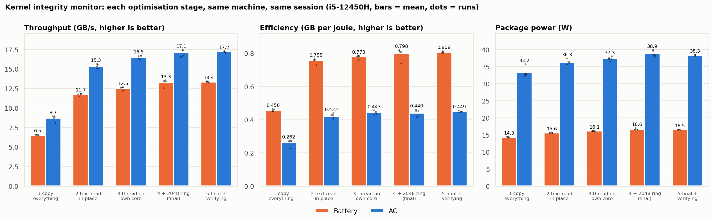
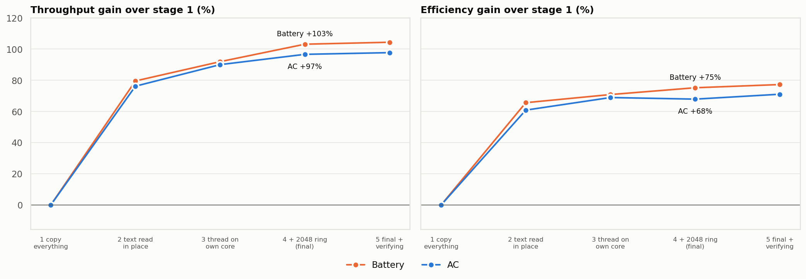

# hardware-accelerated kernel integrity monitor

kim continuously verifies the running Linux kernel. It checks kernel text, the syscall tables and the text and read-only data of every loaded module. Each 16 KiB frame gets an AES-256-GCM-SIV tag, computed with VAES/VPCLMULQDQ on the P-cores of a hybrid Intel CPU. Tags are compared with a baseline learned at start-up.

Legitimate runtime patching, such as static keys and ftrace, is decoded and reported as low severity. Critical events are:

- unexplained code changes
- writable kernel text
- syscall-table changes

Alerts go to the journal, syslog and auditd. The daemon is monitor-only by default. Enforcement is opt-in: it raises lockdown and sets `kernel.modules_disabled`.

**Supported:** Ubuntu 26.04 LTS on Intel Core 12th gen (Alder Lake) and newer.

## Results (i5-12450H, kernel 7.0.0-42)

These are back-to-back scans, 5 runs per stage, all measured in the same session.

| Stage | Battery GB/s | Battery GB/J | AC GB/s | AC GB/J |
|---|---|---|---|---|
| Original: copy everything | 6.53 | 0.456 | 8.70 | 0.262 |
| Kernel text read in place | 11.73 | 0.755 | 15.32 | 0.422 |
| Copy thread on its own P-core | 12.54 | 0.778 | 16.53 | 0.443 |
| **Final (2048-slot ring)** | **13.27** | **0.798** | **17.10** | **0.440** |
| Final, with baseline checking | 13.36 | 0.808 | 17.20 | 0.449 |

Overall, the final pipeline delivers about 2× the throughput of the original copy pipeline and up to 75% more GB per joule. All 50 runs produced a bit-identical digest.




## Layout

| Path | What |
|---|---|
| `kernel_extractor.c`, `kim_uapi.h` | Module 1: kernel module. It exposes a read-only ring and a read-only, never-executable kernel-text window. |
| `ingestion_daemon.[ch]` | User-space ring library |
| `module2_dispatcher/` | Module 2: P/E-core aware dispatcher, power detection, the `kd_daemon` (`kimd`) |
| `module3_verifier/` | Module 3: AES-GCM-SIV tags, baseline learn/check/explain |
| `module4_enforcer/` | Module 4: severity, alerts (syslog/auditd), gated enforcement |
| `packaging/` | `.deb` build: `kim-dkms` (DKMS) and `kim-daemon` (systemd) |
| `*_bench.sh`, `plots/` | Benchmarks and figures |
| `CLAUDE.md` | Detailed design notes, ABI and every measured result |

## Build and test

```bash
sudo apt install build-essential linux-headers-$(uname -r)
make && make -C module2_dispatcher && make -C module2_dispatcher test   # 95/95, no root
make -C module3_verifier test && make -C module4_enforcer test
# Secure Boot: sign kernel_extractor.ko with your enrolled MOK key, then
sudo insmod kernel_extractor.ko && sudo ./test_extractor; sudo rmmod kernel_extractor
```

## Packages

```bash
cd packaging && ./build_debs.sh          # -> packaging/dist/*.deb (no root needed)
sudo apt install ./dist/kim-dkms_1.0.0_all.deb ./dist/kim-daemon_1.0.0_amd64.deb
systemctl status kim; journalctl -u kim -f
```

With Secure Boot on, DKMS signs the module with `/var/lib/shim-signed/mok/MOK.*`. That key must be enrolled; `mokutil --import` it, then reboot.

## License

GPL-2.0 (see `LICENSE`).
